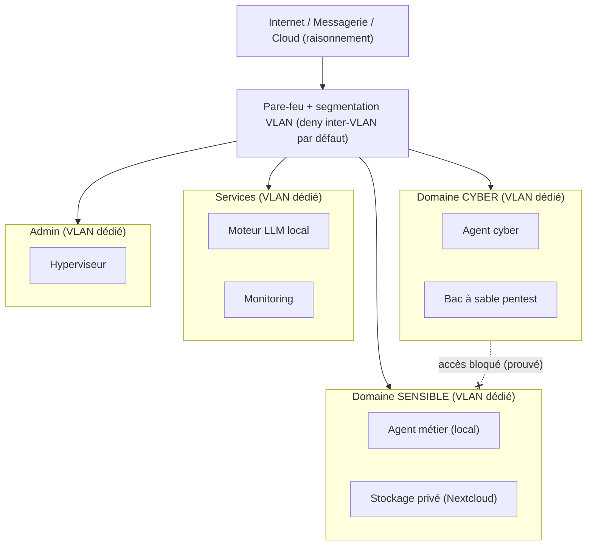

# Architecture de référence

> **Avertissement.** Ce document décrit un *patron d'architecture* réutilisable. Il n'expose ni la configuration exacte, ni les adresses, ni les hôtes d'un réseau en production. Les valeurs réseau citées sont **illustratives**.

## Principe fondateur : le cloisonnement par domaine de confiance

Règle n°1, non négociable : **le domaine à risque (labo cyber) et le domaine sensible (données réglementées) ne partagent jamais ni réseau ni machine.** Une compromission d'un côté ne doit pas atteindre l'autre.

## Segmentation réseau (schéma de référence)

| Segment | Rôle | Accès Internet |
|---|---|---|
| Admin | Gestion de l'hyperviseur et du pare-feu | Restreint |
| Services | Moteur LLM, monitoring | Sortant restreint |
| Cyber | Agent cyber, bac à sable, machines vulnérables | Sortie contrôlée |
| **Sensible** | Agent métier + stockage privé | **Aucun accès direct** ; web via proxy filtrant à la demande |

Règles de pare-feu, de haut en bas (liste blanche) pour le segment **Sensible** :

1. `PASS` DNS vers la passerelle locale
2. `PASS` NTP vers la passerelle locale
3. `BLOCK` tout trafic vers les réseaux privés (RFC 1918) — **cœur de l'isolation**
4. `PASS` sortie Internet (pour les besoins strictement nécessaires)

> L'ordre fait tout : DNS/NTP, **puis** le blocage inter-segments, **puis** la sortie Internet. Le segment sensible peut sortir sur Internet mais ne peut **jamais** joindre un autre segment interne.

## Flux de données

- **L'inférence reste locale, dans le domaine sensible** : aucune donnée réglementée n'est envoyée à un cloud tiers.
- **L'agent cyber** peut utiliser un raisonnement cloud car il ne détient aucune donnée tierce sensible.
- **Accès distant** : via un VPN maillé, ajouté *au-dessus* du réseau, avec des ACL qui empêchent un appareil distant de joindre arbitrairement le domaine sensible. Le lien d'administration de l'hyperviseur ne dépend pas du pare-feu (filet de secours : on garde la main même si le routage casse).

## Pourquoi cette forme

- **Séparer n'est pas filtrer par logiciel.** Reléguer l'isolation à une condition applicative (« le programme n'ira pas lire ce dossier ») est un vœu pieux : un bug ou une compromission efface la barrière. Le réseau, lui, tient.
- **Isolation *prouvée*.** On ne se contente pas d'affirmer l'étanchéité : on la teste (une requête inter-domaines doit échouer). C'est ce qu'un auditeur ou un client exige.
- **Double barrière.** À l'isolation réseau s'ajoute un contrôle d'accès applicatif (comptes, partages) : le principe du *zero trust* appliqué à chaque couche, pas une seule.

## Résilience & exploitation

- Sauvegardes automatiques différenciées (voir [`../examples/backup_strategy.sh`](../examples/backup_strategy.sh)), **vérifiées restaurables**.
- Surveillance du stockage (seuils) et réduction de la surface d'attaque (services legacy désactivés).
- Mises à jour de sécurité suivies ; correctifs des CVE critiques appliqués dans une fenêtre maîtrisée.
