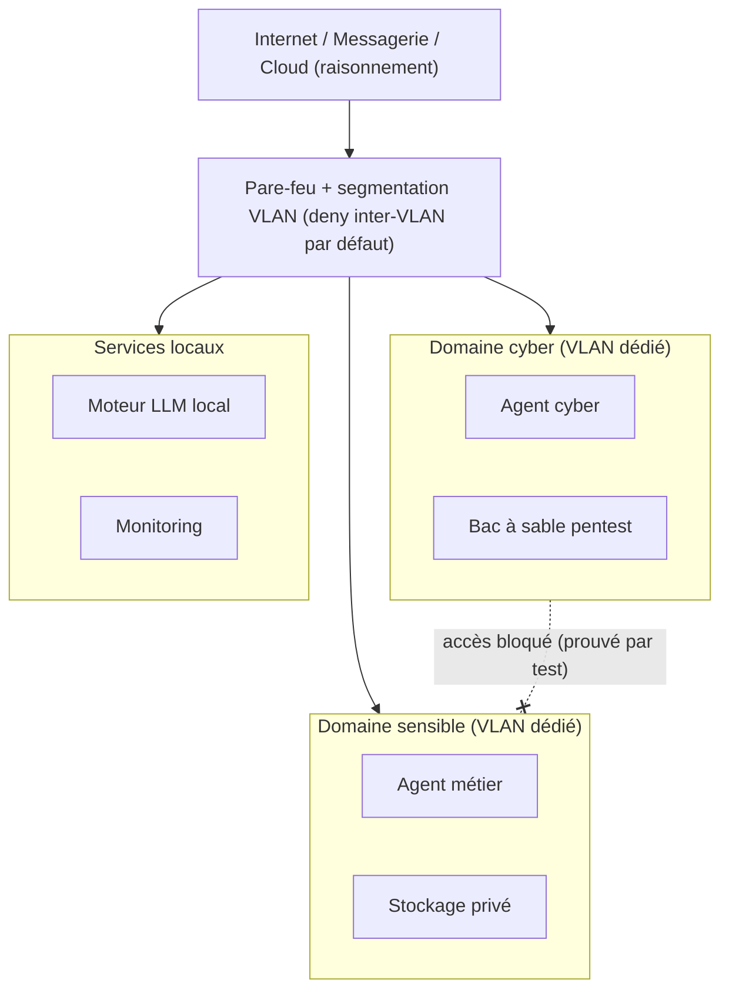

# Royaume IA — Agents locaux & infrastructure auto-hébergée

> Conception d'un homelab orienté **cybersécurité** et **IA locale** : des agents conversationnels auto-hébergés, **cloisonnés par domaine de confiance**, tournant **100 % en local** (CPU, sans cloud), avec la sécurité et la conformité RGPD au cœur des choix d'architecture.

Ce dépôt est une **vitrine d'architecture et de démarche d'ingénierie**. Il documente *comment* et *pourquoi*, avec des exemples de code **génériques**. Le code des produits n'y figure pas (voir [Périmètre & propriété](#-périmètre--propriété)).

---

## 📚 Sommaire

- [Objectif](#-objectif)
- [Vue d'ensemble](#-vue-densemble)
- [Documentation](#-documentation)
- [Exemples de code](#-exemples-de-code)
- [Stack technique](#-stack-technique)
- [Principes de sécurité](#-principes-de-sécurité)
- [Périmètre & propriété](#-périmètre--propriété)

---

## 🎯 Objectif

Construire des assistants IA **privés, fiables et défendables juridiquement** sur du matériel modeste (CPU, sans GPU), en appliquant une sécurité de bout en bout :

- un **agent ops/cyber** — copilote d'infrastructure et de cybersécurité, opérant dans un périmètre **autorisé** ;
- un **agent métier** — assistant pour une profession réglementée manipulant des données sensibles, où **rien ne quitte le serveur**.

Les deux agents partagent un socle commun et sont **isolés l'un de l'autre au niveau réseau**.

---

## 🏛️ Vue d'ensemble

> ⚠️ **Architecture de référence.** Les schémas et exemples décrivent un *patron* réutilisable, pas la configuration exacte d'un réseau en production. Aucune adresse, aucun hôte ni aucun secret réel n'est publié.

L'isolation est **démontrée par test**, pas seulement affirmée : une requête du domaine cyber vers le stockage sensible échoue (timeout). C'est exactement ce qu'un audit demande de prouver.

---

## 📖 Documentation

| Document | Contenu |
|---|---|
| [docs/ARCHITECTURE.md](docs/ARCHITECTURE.md) | Architecture de référence : domaines de confiance, segmentation, flux |
| [docs/SECURITY-MODEL.md](docs/SECURITY-MODEL.md) | Modèle de menace, actifs protégés, limites assumées |
| [docs/DECISIONS.md](docs/DECISIONS.md) | Décisions d'architecture (ADR) et leur justification |
| [docs/ROADMAP.md](docs/ROADMAP.md) | Feuille de route |

---

## 🧪 Exemples de code

Le dossier [`examples/`](examples/) contient des illustrations **génériques et autonomes** de la démarche (pas le code produit) :

- [`minimal_agent.py`](examples/minimal_agent.py) — agent LLM local minimal à *function calling* avec **validation des arguments** (le cœur de la fiabilité anti-hallucination), sur un outil d'exemple anodin.
- [`backup_strategy.sh`](examples/backup_strategy.sh) — squelette d'une **stratégie de sauvegarde différenciée** (ce qui change souvent vs ce qui est lourd et statique), chemins en placeholders.

---

## ⚙️ Stack technique

| Couche | Choix |
|---|---|
| Virtualisation | Proxmox VE (LXC + VM) |
| Réseau / pare-feu | OPNsense, VLANs, deny inter-VLAN par défaut |
| Accès distant | VPN maillé (hors du chemin du pare-feu, comme filet de secours) |
| Moteur LLM | Ollama (modèles GGUF, inférence locale CPU) |
| Agent | Python (bibliothèque standard pour le cœur) + *function calling* |
| Documents | génération PDF / DOCX |
| Stockage | Nextcloud auto-hébergé |
| Sauvegarde | vzdump + sauvegarde applicative ciblée, chiffrée, planifiée, **vérifiée restaurable** |

Modèles : famille **Qwen3 Instruct** (Apache-2.0), servie par Ollama en GGUF. Prêt pour un GPU sans reconfiguration.

---

## 🔒 Principes de sécurité

- **Données sensibles 100 % locales** — le moteur d'inférence tourne dans le segment protégé ; rien n'est envoyé à un cloud tiers (cohérent avec le RGPD, art. 9).
- **Sécurité par l'architecture, pas par le prompt** — la confidentialité repose sur l'isolation réseau + une **liste blanche** d'accès, jamais sur « le modèle promet de ne pas divulguer ».
- **Humain aux commandes** — toute action irréversible (envoi externe) ou à responsabilité (jugement métier) est **préparée** par l'agent et **validée** par l'humain.
- **Pas d'agent offensif autonome** — l'outillage offensif s'exécute dans un labo isolé, lancé par l'humain, dans un périmètre autorisé.
- **Pas d'auto-modification en production** — amélioration = tests + versioning + rollback.
- **Honnêteté** — aucun système n'est « infaillible » ; le projet documente son modèle de menace et ses limites.

Voir [SECURITY.md](SECURITY.md) pour la politique de divulgation.

---

## 🔐 Périmètre & propriété

Ce dépôt publie **l'architecture, la démarche et des exemples génériques**. Il **ne contient pas** :

- le code des agents/produits (propriétaire) ;
- de données réelles, de secrets, d'identifiants ni de configuration de production.

Les produits dérivés de ce travail sont propriétaires et ne sont pas distribués ici. Les exemples de code sont fournis à but pédagogique (voir [LICENSE](LICENSE)).

---

*Projet personnel de homelab — démarche d'apprentissage et de pratique en cybersécurité.*
